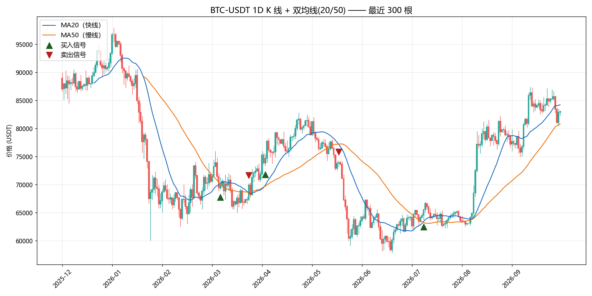

# OKX 行情数据工具箱

> 从 OKX 抓取加密货币 K 线数据 → 存入本地 SQLite（幂等去重）→ 可视化分析。
>
> A lightweight toolkit for fetching, storing and visualizing OKX candlestick data.



---

## 功能

| 功能 | 说明 |
|------|------|
| **抓取行情** | 通过 OKX 公开 API 获取 K 线（无需 API Key） |
| **翻页回填** | 突破单次 300 根的限制，翻页抓取**多年历史** |
| **本地落库** | 存入 SQLite，支持多品种 / 多周期共存 |
| **幂等去重** | 重复运行脚本不会产生重复数据（可安全定时执行） |
| **可视化** | K 线图 + 双均线 + 买卖信号标注 |

---

## 快速开始

```bash
# 1. 安装依赖
pip install -r requirements.txt

# 2. 抓取最近 300 根日线
python fetch_data.py --inst BTC-USDT --bar 1D

# 3. 或翻页回填 2000 根历史（约 5.5 年）
python fetch_data.py --inst BTC-USDT --bar 1D --backfill 2000

# 4. 画图
python plot_klines.py --inst BTC-USDT --bar 1D --n 300
```

输出：
- 数据库：`data/market.db`
- 图片：`images/BTC-USDT_1D.png`

---

## 技术要点

### 1. 幂等写入
`store()` 采用「读取现有数据 → 合并 → 去重 → 整表写回」，因此**重复运行多少次，数据库都保持一致**。去重键为 `(instId, bar, ts)` 三元组 —— 少了 `bar` 会导致 1H 与 1D 数据互相误删。

### 2. 翻页抓取
OKX 的 `/market/candles` 单次最多返回 300 根。要拿多年数据必须用 `/market/history-candles` 配合 `after` 参数**逐页往前翻**，并做本地去重与限流控制。

### 3. 只使用已收盘 K 线
OKX 返回的每根 K 线带 `confirm` 字段：`1` = 已收盘，`0` = 仍在形成中。
**用 `confirm=0` 的数据做决策会造成前视偏差**（用了"还没走完的价格"），因此本工具统一过滤掉未收盘的 K 线。

### 4. 跨平台整数陷阱
时间戳是 13 位毫秒值。Windows 上 `astype(int)` 是 32 位会溢出，必须显式使用 `astype("int64")`。

### 5. 域名容错
部分网络环境下 `www.okx.com` 不可直连。可通过环境变量切换域名：

```bash
# Windows PowerShell
$env:OKX_HOST="https://www.okx.com"
```

---

## 目录结构

```
okx-market-toolkit/
├── fetch_data.py      # 抓取 + 翻页回填 + 落库
├── plot_klines.py     # K 线可视化
├── requirements.txt
└── images/            # 生成的图表
```

---

## 数据库结构

表名 `klines`：

| 字段 | 类型 | 说明 |
|------|------|------|
| `ts` | TEXT | K 线起始时间 |
| `open` / `high` / `low` / `close` | REAL | 开盘 / 最高 / 最低 / 收盘价 |
| `vol` | REAL | 成交量 |
| `confirm` | TEXT | 是否已收盘 |
| `instId` | TEXT | 交易对，如 `BTC-USDT` |
| `bar` | TEXT | 周期，如 `1D` / `1H` |

---

## 说明

- 本工具仅使用 OKX **公开**接口，不需要 API Key。
- 数据仅供研究分析使用，不构成任何投资建议。
